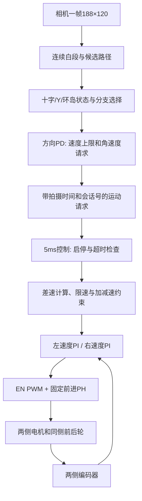

> 2026-11-01：视觉实现已升级V1.1，白线宽度以新版25mm为准；Otsu、外轮廓/截断与方向距离接口详见[V1.1说明](V1.1新版视觉实现说明.md)。本文中的固定阈值和旧视觉流程属于V1.0历史设计。

# V1.0 项目结构、函数调度、主流程与参数说明

本文对应当前实际 C 源码。先看整条链路，再看具体文件。单位统一：距离 m，速度 m/s，角速度 rad/s，控制时间 s；时间戳和超时阈值标 ms。

## 1. 这辆车到底控制什么

参考车是四个轮子，左右各一个电机，同侧前后轮由齿轮联动。软件只控制左侧、右侧两组速度，不能分别调整四个轮子的速度，也没有转向舵机。

直行：左右一样快。右转：左侧快、右侧慢。左转：右侧快、左侧慢。四轮转向会擦地，实际转向程度要用等效轮距修正；编码器只能反映轮轴运动，不能直接测出滑移量。

约定车体前进为正，左转角速度为正。图像白线在画面右侧时，误差为正，方向控制给负角速度，因此左侧目标更快。前提是相机没有镜像，左右电机和编码器符号经过实测统一。



## 2. 文件夹怎么读

| 位置 | 用途 | 通常在哪里改 |
|---|---|---|
| `User` | 这次新增的应用，以及原模板入口和中断 | 日常开发主要在这里 |
| `Core` / `Startup` | WCH RISC-V 内核、启动和向量 | 不随意改 |
| `Peripheral` | WCH 外设库 | 用其 API，通常不改 |
| `Debug` | 模板基础调试实现 | 本版运行调试用逐飞 UART3 |
| `zf_common` | 时钟、延时、日志、FIFO 等 | 保留来源声明 |
| `zf_driver` | PWM、编码器、UART、DVP、SPI 等 | 应用通过适配层调用 |
| `zf_device` | 相机、屏幕等设备驱动及配置静态库 | 接口/设备改变时核对 |
| `Ld/Link.ld` | Flash/RAM 和栈布局 | 已预留两页参数区域 |
| `tools/build.py` | 完整目标构建，生成 ELF/HEX/BIN | 换编译器路径用参数 |
| `tools/test_host.py` / `tests` | 在电脑上测试生产算法源码 | 增加有实际意义的边界案例 |
| `tools/epro_pinmap.py` | 重新提取两个 epro 的电气网络 | 原工程更新时重核对 |
| `docs/hardware` | 引脚链路与可核查 JSON | 接线先看这里 |
| `release/v1.0` | 本次默认配置固件和验证记录 | 自行标定后必须重新构建 |
| `build` | 本机构建中间文件，Git 忽略 | 不手工维护 |

## 3. User 文件与大函数一一对应

| 文件 | 主要函数 | 直白解释 |
|---|---|---|
| `main.c` | `main` | 初始化时钟、零输出、日志、应用，然后一直轮询 |
| `app_boot.c` | `app_boot_init` | 把默认值、实测宏、Flash 参数加载起来，启动外设与节拍 |
| `app_boot.c` | `app_main_poll` | 主循环处理新帧、识别、选路、发布目标和显示 |
| `app_control.c` | `app_control_tick_isr` | 每 5ms 检查状态、测速、限制目标、跑两套 PI、写 PWM |
| `app_exchange.c` | `app_exchange_publish/read_motion` | 在主循环与中断间传整份运动请求 |
| `app_exchange.c` | `app_exchange_publish/read_control` | 发布/读取整份控制状态，避免读到半份数据 |
| `app_exchange.c` | `app_exchange_request/take_requests` | 收集按键请求；STOP 优先处理 |
| `run_manager.c` | `run_manager_step` | 静态、准备、运行、停车、故障的状态转移 |
| `board_port.c` | `board_motor_*` | 实际 GPIO/PWM 操作，屏蔽引脚细节 |
| `board_port.c` | `board_clock_*`, `board_time_*` | TIM7 微秒时基，TIM6 持续扩展计数 |
| `board_port.c` | `board_irq_save/restore` | 用 WCH 内核 CSR 保存/恢复中断开关，保护短数据交换 |
| `board_port.c` | `board_camera_hold/restart_*` | 暂停 DVP 和 DMA，重启接收 |
| `board_port.c` | `board_key_code` | 读取 74HC148 的三位编码，不是直接读一个按钮 |
| `motor.c` | `motor_apply_forward/brake_zero` | 统一限幅并输出；非法输入回零 |
| `side_encoder.c` | `side_encoder_sample` | 连续计数、回绕、正负号、速度和轮周里程 |
| `speed_control.c` | `speed_pi_step` | 每侧一套 PI，抗积分饱和 |
| `motion_plan.c` | `motion_plan_step` | 把车速与角速度变成受约束的两侧目标 |
| `camera_frame.c` | `camera_frame_on_done_isr` | 帧完成时冻结缓冲，记录拍摄完成时间和帧号 |
| `camera_frame.c` | `camera_frame_acquire/release` | 主循环借一帧，处理完必须归还 |
| `vision_line.c` | `vision_line_process` | 二值白段、多候选路径和交叉/分叉证据 |
| `track_element.c` | `track_element_step` | 按当前元素状态选一条路径、限速或请求停车 |
| `vehicle_progress.c` | `vehicle_progress_rear_clear` | 近似判断后轮是否已经清出，不只看相机 |
| `path_control.c` | `path_control_step` | 选中路径算横向误差，PD 生成角速度 |
| `vehicle_param.c` | `param_defaults/valid/can_arm` | 参数默认值、数值合法性、发车前提 |
| `vehicle_param.c` | `param_encode/decode` | 明确字节格式、版本、序号、CRC、提交标记 |
| `param_store.c` | `param_store_load/save` | 双槽选择有效新记录、写另一个槽 |
| `debug_view.c` | `debug_view_poll/frame` | 按键消抖、状态文字、静态二值图、停车保存 |
| `app_math.c` | `app_count_delta`, `app_crc32` | 小型基础计算 |
| `zf_isr.c` | `TIM6_IRQHandler`, `DVP_IRQHandler` | 在模板原中断里接入控制节拍与帧完成回调 |

`app_types.h` 放共享结构；`app_core.h` 放纯计算函数声明；`app_runtime.h` 放运行时接口。`board_config.h` 管接线，`vehicle_calibration.h` 管实测数据，`track_profile.h` 管现场路线，`app_config.h` 管编译期容量和周期。

## 4. 上电以后按什么顺序运行

```text
main
  clock_init(144MHz)
  motor_init_zero                 EN先低，PH初值，PWM=0
  debug_init                      UART3 PB10/PB11
  app_boot_init
    board_clock_init / controls_init
    param_defaults + CAL_*实测宏
    param_store_load              有效Flash记录优先
    side_encoder_init
    app_control_init              状态STATIC，会话号1
    pit_ms_init(TIM6_PIT,5)        开始周期控制
    camera_frame_init             初始化DVP，建立帧所有权
    app_control_camera_ready
    debug_view_init
  for ever: app_main_poll
```

初始化相机、屏幕可能耗时，但控制节拍已运行，非运行态保持 PWM=0。相机失败不会假装就绪；未经标定也不能进入 READY。

默认 Flash 若有以前保存的有效记录，会覆盖编译宏。修改实测宏后仍读到旧值时，先在下载工具中擦除参数区域或整片擦除，再烧录。不能把“代码改了”当成“保存参数也自动更新了”。

## 5. 主循环与中断分别干什么

每次主循环先读控制快照。会话变化时清空选路和方向历史。拿不到新帧就只处理按键与诊断；拿到新帧才识别，不反复用同一帧更新方向 D 项或元素进度。

```text
借一帧 → 扫白段 → 选路径/元素状态 → 方向PD → 发布运动请求
       → 静态模式按需显示这帧 → 归还 → 重启采集
```

每 5ms TIM6：

```text
扩展时基 → 算实际dt → 检查标定与相机 → 编码器反馈
  → 读当前运动请求，检查会话和拍摄时间
  → 消费本地启停请求
  → 运行中检查编码器、图像超时、元素停车
  → 差速运动规划 → 左PI → 右PI → PWM
  → 发布状态快照
```

中断不扫描整张图、不刷新屏幕、不打印运行日志、不擦 Flash。主循环和中断交换结构时只短暂关中断，复制之后恢复原开关状态。没有用 `volatile` 冒充整份结构的原子性。

## 6. 启停和故障

| 状态 | EN 输出 | 如何进入下一步 |
|---|---|---|
| STATIC_DEBUG | 0，刹车 | 标定有效且两侧静止，按中键 → READY |
| READY | 0，刹车 | 当前会话有新鲜有效图像，按 KEY1 → RUNNING |
| RUNNING | 运动规划＋两侧 PI | KEY2 或元素停车 → STOPPING；严重错误 → FAULT |
| STOPPING | 目标沿当前转向一起降到零 | 目标归零 → STATIC_DEBUG |
| FAULT | 立即 0，清控制历史 | KEY2 清故障回 STATIC，再重新准备 |

`RUN_BOOT` 预留在枚举中，当前初始化直接发布 STATIC。STOP 与 START 同时出现时 STOP 优先。READY 和重新准备时会清空旧请求或更新会话号；旧会话的目标无效。

故障码：0 无；1 本地停止；2 图像失效；3 编码器异常；4 非有限数；5 时序异常；6 元素请求停车；7 配置错误枚举预留。当前配置缺项会阻止 READY，不主动产生配置 FAULT。

视觉软超时 150ms 先减速；硬超时 600ms 回零进入故障。单次控制 dt 超过 20ms 在运行时故障；单次执行超过 4ms 累计 3 次在运行时故障。`overruns` 为累计值，后续实测可再调整为窗口统计。

KEY2 是软件停止，处理依赖主循环轮询和中断正常工作，不等于独立硬件急停。芯片自带故障保护与 MCU 可读取故障信号也不是同一件事；本板 nFAULT 没有接回。

## 7. 路况和结构怎样对应

| 路况 | 识别/状态 | 两侧轮子怎么动 |
|---|---|---|
| 普通直线 | 单一连续路径 | 近似等速，PD 微调 |
| 普通弯道 | 路径位置与趋势变化 | 弯外侧快、内侧慢，按弯道速度限幅 |
| 十字 | 多行宽白带，稳定确认 | 保留前向路径通过，禁止按横带选转向 |
| Y | 分支＋路线身份 | 第一圈左支、第二圈右支，随后锁定该支 |
| 环岛 | 已配置入口、内部跟随、出口重遇 | 降速，连续差速跟随，满足进度条件才允许出环 |
| 刚看到出口 | 视觉单线恢复 | 先继续通过，后轴清出后才释放元素状态 |
| 全黑/全白/白段过多 | 可信度不足 | 不刷新有效目标；超时减速和停止 |
| 未配置的分叉 | 无法区分 Y/环岛 | 请求停车，不随机猜支路 |

后轴清出近似门槛：清出后新增轮周距离 > 相机前移量＋近行前向距离＋半轴距＋余量，并满足稳定释放时间。这个近似依赖低速和已标定视野；急弯、严重滑移需要额外验证，不是准确三维定位。

环岛当前传入 `yaw_valid=false`，没有假装读到 IMU 航向。因此 `island_min_turn_rad` 仅为以后接入真实航向的可选附加门槛，V1.0 默认不会靠它证明完整一周。

## 8. 参数去哪里改

实测值优先填 `vehicle_calibration.h`；算法默认参数在 `vehicle_param.c::param_defaults`；硬件对应在 `board_config.h`。修改并重新编译。V1.0 没有串口参数编辑器，没有运行中参数热更新。

### 8.1 实测与发车条件

| 宏/字段 | 意义和填写方法 |
|---|---|
| `CAL_WHEEL_LEFT_M/RIGHT_M` → `wheel_left/right_m` | 两侧负载下有效轮径；默认 0，必须实测 |
| `CAL_TRACK_M` → `track_m` | 左右轮中心距；默认 0 |
| `CAL_AXLE_M` → `axle_m` | 前后轴中心距；默认 0 |
| `CAL_COUNTS_LEFT/RIGHT` → `counts_left/right` | 每侧轮端一圈有效计数；默认 0 |
| `CAL_ROW_NEAR_M/FAR_M` | 静止地面上近端/远端采样行对应前向距离；必须远大于近 |
| `CAL_CAMERA_FORWARD_M` | 相机相对车体轴间中心的前移距离 |
| `CAL_MASK` | 位0几何、位1编码器、位2方向、位3图像、位4时序；全部验证才为31 |
| `CAL_CAPTURE_VALIDATED` | 实测帧暂停/重启可靠后设1；不是相机初始化成功就设1 |
| `CAL_FULL_RACE` | 0 普通训练；1 正式路线模式，需要完整现场事件配置 |
| `encoder_sign[2]` | 在 `param_defaults` 中设置各侧 +1/-1，统一轮子前进计数为正 |
| `effective_track_m` | 默认0，表示先用几何轮距；实测转向后填写等效值 |

数值校验还检查 NaN/无穷大、轮径/轮距范围、占空比/时间范围。不能只改掩码来绕过尺寸和计数为零的检查。完整比赛还要求 `APP_ROUTE_LENGTH>0` 和终点距离大于0。

### 8.2 速度闭环、方向与限幅

| 参数 | 默认值 | 直白说明 |
|---|---|---|
| `encoder_tau_s` | 0.025 | 测速滤波时间常数，过大反应慢 |
| `kp_left/right` | 0.2 / 0.2 | 侧速度 P，误差立即影响占空比 |
| `ki_left/right` | 0.4 / 0.4 | 侧速度 I，补长期偏差 |
| `ff_left/right` | 0 / 0 | 速度前馈，测出速度与占空比关系后再用 |
| `integral_limit` | 0.2 | 积分贡献绝对值上限 |
| `duty_limit` | 0.25 | 最高25% EN，占空比不是电流；校验上限0.8 |
| `speed_limit_mps` | 0.4 | 任一侧最高速度 |
| `accel_mps2/decel_mps2` | 0.3 / 0.6 | 目标增速/减速斜率 |
| `inner_ratio` | 0.15 | 内轮最低比例约束，减少零速附近急旋 |
| `visual_kp/kd` | 1.5 / 0.05 | 图像误差 P 和变化率 D，输出角速度 |
| `visual_tau_s` | 0.05 | D 项滤波时间常数 |
| `center_x_px` | 93.5 | 图像目标中心，依据装配与画面实测修正 |
| `speed_normal` | 0.2 | 普通目标车速上限 |
| `speed_corner` | 0.12 | 弯道速度上限 |
| `speed_element` | 0.1 | 十字、Y、环岛等状态速度上限 |

例如车速 0.2m/s、等效轮距0.14m、请求右转角速度 -1rad/s，未触发其他限幅时左右目标为0.27和0.13m/s。PI 各自追踪目标。轮子打滑时，实际转弯还会偏离这个计算值。

### 8.3 识别、进度和超时

| 参数 | 默认值 | 用途 |
|---|---|---|
| `threshold` | 130 | 0～255，像素大于它算白；结合曝光和蓝布调 |
| `width_near_px/far_px` | 20 / 5 | 近远端白线宽度参考，用于分叉间距判据 |
| `row_jump_px` | 28 | 相邻采样行候选路径允许的位置变化 |
| `confirm_ms` | 80 | 持续证据多久才确认元素转移 |
| `release_ms` | 120 | 单线与清出稳定时间 |
| `clear_distance_m` | 0.12 | 后轴清出额外余量 |
| `island_min_distance_m` | 0.5 | 出环允许前至少走的轮周距离，须按现场环岛标定 |
| `island_min_turn_rad` | 5.4 | 接入真实航向后才启用的累计转向门槛 |
| `soft_timeout_ms` | 150 | 图像目标变旧后开始减速 |
| `hard_timeout_ms` | 600 | 图像仍未恢复则故障停车 |
| `element_timeout_s` | 20 | 元素状态超时降级停车 |

`row_distance_far_m` 在当前版本用于标定合法性约束，尚未做完整透视投影；`merge` 图像特征和 `expected_y_count` 是预留信息，实际 Y 汇合转移依靠分叉消失与稳定时间。不要把字段存在当成功能已全部使用。

### 8.4 现场事件序列与两圈

在 `track_profile.h` 配置**一圈内依次遇到的分叉元素**。0～7 代表不同 Y 的固定身份；128 代表环岛。十字由通用直行状态处理，不占这个序列。

```c
/* 只是格式示例，不是从考核图推断出的现场路线。 */
#define APP_ROUTE_LENGTH 3u
#define APP_ROUTE_SEQUENCE {0u, 128u, 1u}
#define APP_ISLAND_ENTER_BRANCH 0u
#define APP_FINISH_DISTANCE_M 0.6f
```

示例表示一圈 Y0、环岛、Y1，第二圈重复。事件只有后轴清出才计数；每个 Y 用 `passed_mask` 记录左/右。累计走完两圈事件后，要求所有 Y 的 mask 为3，再按实测终点距离请求停止。终点距离从最后元素后轴清出的时刻起算。

事件顺序若不对或视觉误把额外岔路当元素，就可能选错身份；本版没有自动地图定位。必须逐元素验证，不能直接照用示例。相邻两圈的最后元素至第一个元素应能由普通循迹连续连接；若终点距离途中还有额外分叉，当前路线表示要扩展。

### 8.5 内存、持久化与编译选项

图像容量188×120=22560字节；只保留一张图。每行4白段、最多4路径；容量溢出拒绝作为有效视觉请求。固定数组无动态图像分配。

链接允许248KiB Flash、32KiB RAM，栈固定2KiB。Flash 的物理地址 `0x0803E000` 与 `0x0803F000` 各预留4KiB。当前固件在别名地址0链接，由 WCH 下载工具映射到芯片 Flash；参数操作使用0x080…物理地址。不要选择会覆盖参数保留区的旧链接脚本。

参数每条256字节，明确序列化 float32，含版本、序号、CRC32，最后4字节提交标记最后写。启动选有效且更新的一槽。写失败仍保留另一槽；这不能替代供电和掉电实测。保存后立即复位，避免擦写暂停影响时基。

当前没有启用 IMU、硬件看门狗或驱动故障反馈。`APP_ENABLE_TFT`、`APP_ENABLE_PARAM_FLASH` 是预留宏，V1.0 尚未据其裁剪驱动，若需去屏或去 Flash 请修改实际调用后重新验证。

## 9. 按键如何用

| 操作 | 生效条件 | 动作 |
|---|---|---|
| 五向中键 | STATIC 且标定/静止条件通过 | 准备 |
| KEY1 | READY 且图像新鲜 | 开始运行 |
| KEY2 | RUNNING | 平滑停车 |
| KEY2 | FAULT | 清故障回静态 |
| 五向右键 | STATIC | 文字/二值图切换 |
| 五向下键长按2秒 | STATIC、两侧静止且参数数值合法 | 保存参数后复位 |

按键消抖40ms。没有远程启动、遥控转向或串口改参。实际设备屏幕型号需要与 TFT180 核对；引脚一致并不能保证所有 TFT 控制器通用。

## 10. 如何判断当前验证结论

`release/v1.0/build-report.json` 记录工具链版本、源码数量、尺寸、第三方原有警告和固件校验值；`test-report.json` 记录默认路线与配置路线的回归结果。

这些证据证明当前源码能生成目标机器码、已测纯算法案例通过。它们不证明电机机械方向、完整相机帧、上板中断最坏耗时、RAM 栈峰值、出环拓扑和赛道两圈已经验证。上板后按[书写与验证流程](V1.0代码书写流程.md)逐项完成。
