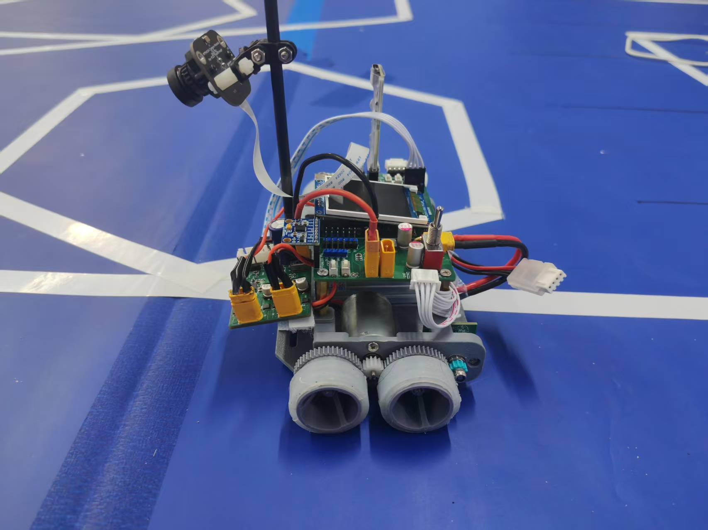
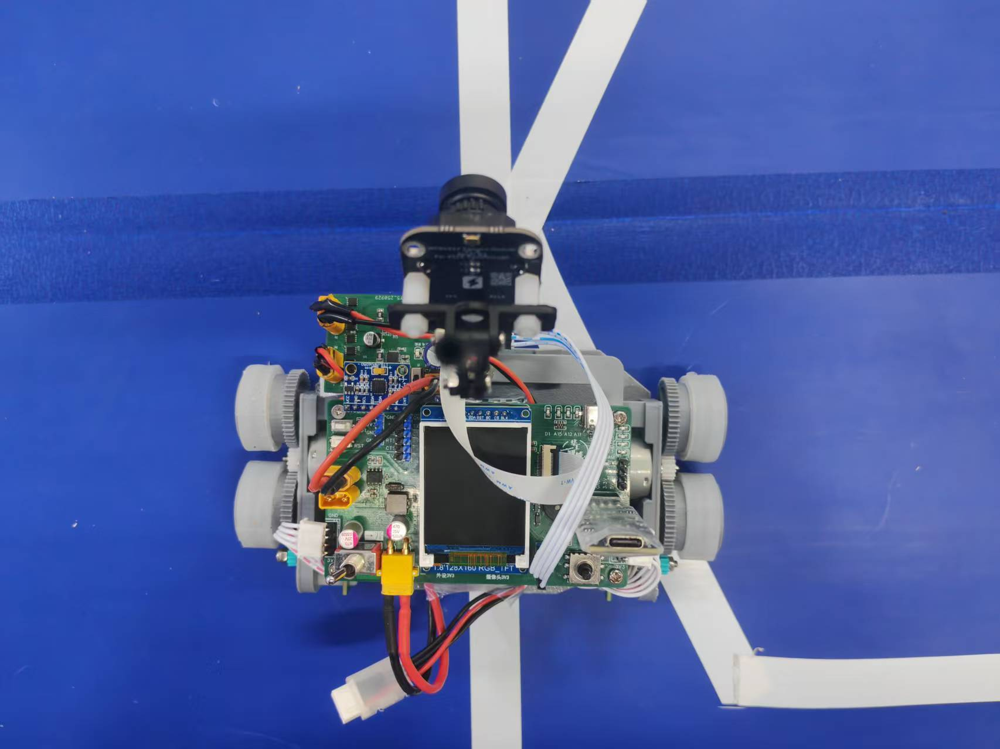

# 四轮齿轮联动差速车电控算法开发文档

对应固件V1.2，更新2026-11-01。当前已有可编译固件，本文解释实际算法和调试方法；不是未来占位接口说明。源码、参数和调用顺序见[项目结构与主流程参数说明](项目结构与主流程参数说明.md)。

## 读完这篇应该能回答什么

这篇先回答“车为什么这样转、算法为什么这样分”。读完应能说清四件事：四个轮子由哪两个电机带动；相机怎样选目标；方向怎样变成左右速度；遇到路口为什么不能只看一帧。

阅读顺序：本篇理解原理 → [结构说明](项目结构与主流程参数说明.md)找到文件和参数 → [书写流程](代码书写流程.md)按阶段实践 → [代码开发文档](智能车完整代码开发文档.md)查真实接口。没有学过的术语，结构说明开头有白话表。

### 用一次右转串起整条链路

假设目标点比画面底部参考点向右30像素、向前40像素，视觉得到方向约+0.644rad、像素距离50px。正方向表示“目标在右边”，不是车已经转过这么多度。

电控看到右侧目标，给负的车体角速度。再假设经过PD和约束后请求车速0.2m/s、右转角速度-1rad/s，等效轮距0.14m，那么左右目标分别是0.27和0.13m/s：左侧前后轮快，右侧前后轮慢，车头向右。

两侧速度PI再根据编码器实测速率调各自PWM。不能从上述两个目标直接推断各侧是多少占空比，实际负载、电机和参数都会影响输出；实际轮速还会按加减速约束逐步接近目标。

接下来读各章，就是拆开解释这个例子中每一步的原因。

## 1. 实际车模结构

### 0.1 本文适用什么车

“二轮考核”指第二轮考核。细则第2页提供了两张参考车模照片；从照片可以进一步确定结构，不能再把车轮布局当成完全未知。

**图片直接可见：**四个轮子，左右各两个；侧面前后轮均有大齿轮；两轮之间的小齿轮同时与两个大齿轮啮合；摄像头装在高支架上；控制板和屏幕在上层。可见部分没有转向舵机或转向拉杆。

**结合图片和双路电机驱动板的结构判断：**该参考车应为左右两侧分别驱动的四轮差速车，同侧前后轮由齿轮关联，转弯时通过两侧速度差产生偏航，并伴随轮胎横向擦地。这属于四轮差速滑移转向模型。背面未完全展示，电机与每侧传动的对应关系仍需实物确认。

本文据此采用四轮差速滑移转向作为参考车的开发模型。若你购买的是细则中的同款车，可直接按这个开发顺序推进；电机标号、齿轮齿数、轮径、轮距、前后轮轴距仍需测量。





### 0.1.1 四个轮子如何被两路电机控制

按照片所示传动，示意如下；不表示精确尺寸和电机实际位置：

```text
                 摄像头观察方向 / 车前方
                         ↑
       左前轮 ○                         ○ 右前轮
              ╲ 同侧齿轮传动   同侧齿轮传动 ╱
          左侧电机/小齿轮       右侧电机/小齿轮
              ╱                         ╲
       左后轮 ○                         ○ 右后轮

       左路PH/EN控制这一侧      右路PH/EN控制这一侧
```

同一个小齿轮直接啮合两个大齿轮时，两只大齿轮都与小齿轮反向，因而同侧两只轮子彼此同向。若两只大齿轮齿数和轮胎有效直径相同，同侧前后轮理论圆周速度相同。

因此程序首先控制两条“侧速度”：左侧速度、右侧速度。只有两套电机输出、两套侧速度闭环；前后四个轮子的运动由两侧机械传动关联，无法分别下发四个独立轮速。

若前后轮有效直径不同，它们即使角速度相同，圆周速度也不同，会互相拖拽。装胎与清洁时要关注同侧前后轮的一致性。

### 0.1.2 四轮转弯为什么更难

两轮模型可以让两只轮子分别沿圆弧滚动。四只固定方向的轮子分布在前后两根轴线上，转弯时无法同时满足四个接触点都纯滚动，所以轮胎会有横向滑移和变形。

这使实际转弯能力受以下因素影响：前后轮轴距、左右轮距、车重和重心、轮胎材质、地面抓地、速度、电机输出。两侧速度差相同，在不同表面上的实际转向角速度也可能不同。

开发安排因此调整为：先用理想差速公式生成目标，再靠视觉反馈修正方向；有IMU时测量实际角速度；通过低速圆弧实验标定等效轮距。急弯提前降速，避免用突然原地旋转作为常规循迹动作。

### 0.1.3 对电机采购与安装的影响

图片显示车模已有外露小齿轮驱动轮端大齿轮的结构。更换电机必须匹配安装孔位、外形、轴径轴长、小齿轮模数/齿数及轴中心位置。图片不能读出电机具体型号，也不能证明常见JGA25-370一体减速电机可以直接装入。

这台外齿轮底盘优先使用配套电机。2S电池条件下，7.2V模型用RS-380PH可作为核对候选，仍须确认安装孔位、2.3mm轴径、轴长和齿轮配合；不能从照片断言可直装。总传动比还必须包含外露齿轮级。

### 0.1.4 摄像头与重心

摄像头位于高支架上，有利于看见更远的线路，但振动和车身俯仰会改变图像里白线的位置及比例。支架刚度、镜头锁紧和FPC固定属于视觉调试的一部分。

电池位置在照片中不能完整确定。安装时尽量降低重心、保持左右载重对称，线缆不能碰轮胎和齿轮。不能用照片中电路板的高低位置直接推断整车重心。


## 2. 场地、任务与硬件约束

最新视觉大纲规定蓝色背景、25mm白线、平行赛道间距20cm，前置摄像头最大188×120灰度图。直线、90°及连续弯道、十字、分叉和环岛都需处理；旧20±2mm描述已由新版25mm替代。原图见[视觉大纲](assets/visual-outline-2026-11-01.jpg)。

原考核的两圈、十字直行、分叉两支分别通过、环岛绕一周及发车后禁止通信干涉继续作为任务依据；新版视觉大纲未说明取消它们。现场起终点图形和环岛拓扑仍需确认，不能假定有特殊结束条纹。

CH32V307VCT6控制两路DRV8701E，左EN PE9/PH PE11、右EN PE14/PH PE13，编码器左PA0/PA1、右PD12/PD13。前提是主板H3与驱动CN5同脚号直连。EN=0为刹车，PH为电气方向；机械前进极性须验证。板上没有接回可用电流/故障反馈，不实现电流闭环。逐针链路见[硬件核对](hardware/引脚与驱动核对.md)。

用户电池选择为2S标称7.4V、满电8.4V。替代电机采购还需匹配轴径/轴长、安装孔位、小齿轮模数/齿数与堵转电流，照片不能证明具体型号可直装。

## 3. 视觉：先选路，再给方向与距离

Otsu求全帧阈值 → 底部附近找种子 → 四连通扫描线取本车道路 → Moore八邻域追踪外轮廓 → 画面周边截断区间/折点 → 30行候选路径 → 多帧元素状态 → 目标点几何。

连通域位图2820字节，Otsu直方图与种子栈复用512字节。全黑、全白、低对比度、追踪不闭合或容量溢出不能发布有效路线。相互独立的平行白线被过滤；道路被遮挡断开时远端不会被凭空补连。

截断按道路与画面边缘相交的连续白区间计数，不按单个边界像素计数。四区间且覆盖四边是十字候选，三区间是分叉候选，四区间偏同侧是环岛候选；候选结合现场路线身份和确认状态使用，不能单帧直接认定元素。

直线取出口中点；十字强制对面上边出口；普通弯道用选中出口并参考近处同侧折点；分叉锁定选支；环岛分阶段进入、跟随、出口重遇和清出。当前只跟一条外轮廓，未枚举所有内部孔洞，折点左右标签为画面半区，完整折点几何策略和真实环岛效果尚待改进/验证。

视觉 `VisionOutput` 的方向角右为正，距离为像素。默认底部参考点为(93.5,119)：

```text
 dx = target_x - center_x_px
 dy = max(1, 119 - target_y)
 direction_rad = atan2(dx, dy)
 distance_px = sqrt(dx² + dy²)
```

像素距离未换成米，当前未用于自动距离减速；画面角也不等于准确车体转角。视觉不生成omega或PWM。详细实现和实际限制见[视觉链路说明](视觉链路实现说明.md)。

## 4. 电控：方向角变成左右两侧速度

电控 `control_path_step` 读取VisionOutput，验证会话、帧身份和数值，并运行方向PD：

```text
 e = direction_rad
 omega_raw = -(visual_kp * e + visual_kd * filtered_derivative)
```

D按新帧拍摄时间计算，目标切换或时间间隔异常时清D。负号将“画面右为正”转换为“车体左转为正”。方向PD增益归 `User/config/control_tuning.h`，不能与像素误差PD的旧参数直接等同。

设目标车速v，等效轮距b，左转角速度ω：

```text
 v_left  = v - ω*b/2
 v_right = v + ω*b/2
```

四轮擦地使其成为控制近似。b优先使用effective_track_m，没有实测值先用几何track_m；车头实际转向需靠视觉或真实航向反馈验证，不能把轮周差分当准确偏航。

运动规划限制侧速度、车速增减斜率和内轮比例。超限时成对缩放目标，停车时v和ω一起收敛到零。普通循迹固定前进PH，仅EN占空比变化，不主动反转内轮追线。

每侧一套速度PI：误差=目标侧速度−测量速度；P响应当前误差，I补长期偏差。输出0～duty_limit，饱和时拒绝继续向饱和方向积分。占空比只是驱动比例，不等于电流限制。

## 5. 测速与通过进度

每5ms连续读16位CNT，做模65536有符号差分，不周期清零。要求采样间隔内变化小于32768。逐飞库TI2计数模式下，实际手转轮子一圈测counts_left/right，不能想当然用PPR×4。

```text
 本周期侧轮周距离 = π * 有效轮径 * 有效计数增量 / 轮端一圈有效计数
 测量速度 = 侧轮周距离 / 实际dt
```

速度做一阶滤波，里程累积原始距离；若编码器位于电机轴，轮端计数包含所有减速级。齿隙、齿轮松脱与轮胎滑移都会影响运动，轮周里程不是准确对地距离。

元素解除要等后轴清出：相机看到单线后，结合相机前移量、近行前向距离、半轴距和余量，继续行驶并保持稳定释放时间。不能仅因相机看到出口就释放转向。

## 6. 元素与两圈状态

十字确认→直行通过→稳定单线→后轴清出。Y确认→按该Y历史选择左/右支→锁定→汇合→后轴清出才记完成，第二圈走另一支。

环岛按现场入口支进入、内部跟随，最短轮周进度与出口重遇满足后才退出，之后后轴清出。当前没有IMU，yaw_valid=false，island_min_turn_rad没有提供实际航向门槛；不能据此宣称通用环岛一周已被严格证明。

`User/config/track_profile.h` 配一圈分叉元素顺序，0～7是不同Y身份，128是环岛。正式模式需完成两圈事件、每个Y的左右支mask=3及最后元素清出后的实测终点距离。空配置遇无法分类分叉停车。序列不是自动地图，误识别会影响事件身份，必须实地逐元素验证。

## 7. 调度、参数和开发验收

主循环做视觉与方向PD；TIM6每5ms做测速、运行状态、超时、差速和两侧PI；DVP中断做帧冻结。完整调用、全部参数和单位见[主流程参数说明](项目结构与主流程参数说明.md)。

视觉调参在vision_tuning，方向PD/轮速PI/限幅在control_tuning，实车数据在vehicle_calibration，路线在track_profile。有效Flash会覆盖编译默认值。先静态帧与计数、再低占空比方向、再速度PI、普通循迹和逐元素验证，最后完整两圈；具体顺序见[书写与验证流程](代码书写流程.md)。

当前已完成目标编译和电脑回归/独立链接测试，未烧录或实车跑赛道。默认尺寸/计数/标定位为空，CAL_VISION_V2_VALIDATED=0，不能直接发车。完整Flash与RAM记录见release/v1.2，2KiB栈峰值与图像最坏耗时待上板测量。
